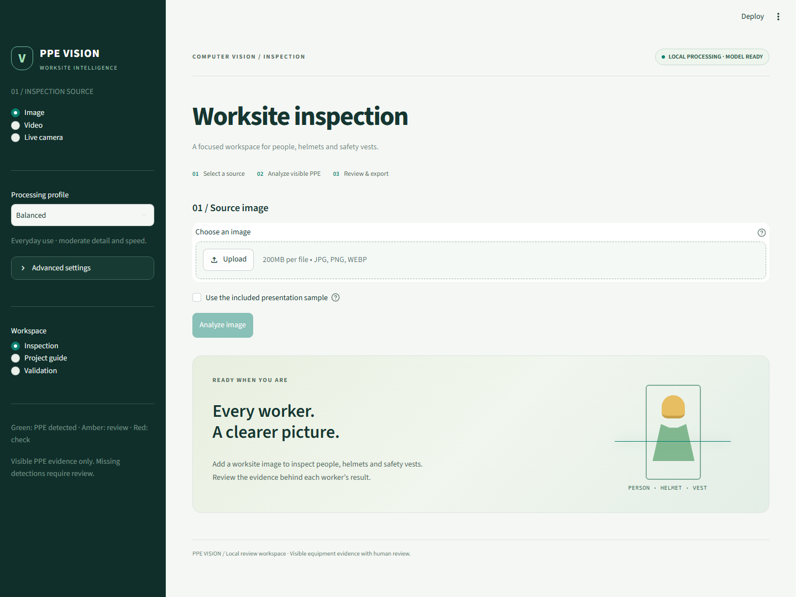
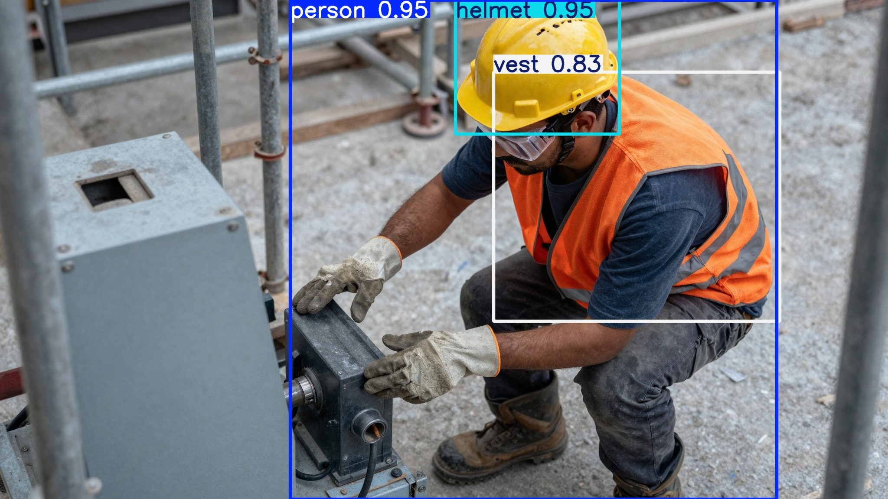

# PPE Vision — Worker PPE Review

A semester AI project using a fine-tuned YOLO11 nano model to detect workers,
helmets and high-visibility safety clothing. Development follows seven phases
covering data, training, worker-level PPE checks, video and final evaluation.

**Presentation milestone (16 November 2026):** the redesigned inspection workspace,
image/video/camera pipelines, worker evidence, tracking, regression checks and
current documentation are implemented. Independent final evaluation is pending test data. Geometry
matches and model detections do not establish wearing state or workplace safety.

[Project report (PDF)](docs/PPE_Project_Comprehensive_Report.pdf) ·
[Presentation slides (PDF)](docs/PPE_Presentation.pdf) ·
[Pipeline](docs/pipeline.md) · [Code & viva guide](docs/code-walkthrough.md) ·
[Demo checklist](docs/presentation-guide.md) · [Final audit](docs/final-audit.md)



## What works

- Detect `person`, `helmet` and `vest` using selected PPE weights.
- Export annotated JPEG and JSON into a unique directory for every image run.
- Match plausible helmet/vest regions to workers, flag ambiguity and explain
  per-worker statuses using `ppe assess`.
- Process recorded video/webcam frames with one loaded model, save annotated MP4
  and streaming JSONL, and report measured processing speed.
- Reject missing/corrupt images and invalid confidence/image-size values.
- Reproduce dataset preparation and Colab GPU training.
- Review recorded configuration, metrics, provenance and failure analysis.

The source `vest` label includes high-visibility jackets and shirts. Worker-level
statuses are conservative heuristics; detecting a helmet does not prove it is worn.



*Validation image with local predictions: integration evidence, not an independent
accuracy result. [Attribution and changes](docs/dataset-attribution.md).*

## Open the interface

```powershell
.\.venv\Scripts\python.exe -m pip install -e ".[ui]"
.\.venv\Scripts\python.exe -m streamlit run app/streamlit_app.py
```

Open http://127.0.0.1:8501. Upload an image or video, choose Balanced/Detail/Fast,
and analyze. For a repeatable demonstration, select **Use the included presentation
sample** in Image mode. Results have annotated/source-comparison tabs, filterable
worker evidence and selected-file downloads. **Project guide** explains the pipeline;
**Validation** reads the saved development metrics. The workspace uses compact corner markers,
lossless image exports and browser-compatible video previews. Video defaults to a
300-frame preview; choose 0 for a full export. Recorded playback defaults to the
same monitor dashboard as the live camera, with synchronized worker cards and
person/helmet/vest confidence scores on frames. Video options offers a frame-only
view, and Advanced settings can hide scores or show equipment boxes.
Live camera and Smooth live review now default to **In this browser**.
Press **Start live camera** or **Start live review**; the dashboard appears below
with a **Stop live preview** control. The optional **Desktop window** choice
retains native monitoring (Tab changes focus; Q/Esc stops).

For smoother HD capture from the terminal:

```powershell
.\.venv\Scripts\ppe.exe webcam --camera 0 --low-latency --track --image-size 416 --capture-width 1280 --capture-height 720 --capture-fps 30
```

Camera settings require driver support. Display FPS and AI assessment rate are
measured separately; increasing playback FPS does not add camera frames or improve
AI speed. Source detail also depends on focus, lighting and upstream compression.
See [interface and quality guide](docs/phase-6.md) and
[final evaluation workflow](docs/phase-7.md).

## Baseline results

Before presenting, run the repeatable software and actual-model rehearsal:

```powershell
.\.venv\Scripts\python.exe scripts/verify_presentation.py
```

It creates a new evidence folder under `outputs/` and checks dependencies, the
automated suite, real CPU image inference and H.264 video integrity. It does not
open a physical camera or establish independent accuracy. See the
[final audit](docs/final-audit.md) for current findings and verification limits.

Trained on a Colab Tesla T4 for 30 epochs, image size 640, batch 8 and seed 42,
using **799 training and 200 validation images**.

| Validation metric | Reported result |
| --- | ---: |
| Mean precision | 94.99% |
| Mean recall | 83.54% |
| mAP@0.5 | 90.08% |
| mAP@0.5:0.95 | 71.15% |

These are development measurements, not overall real-world accuracy. Helmet recall
is weakest (76.53%). Recurring/generated scenes limit validation independence.
An independent real-camera test set and sustained deployment benchmarks are pending.
See [training review](docs/phase-3-results.md), [experiment log](docs/experiments.csv)
and [baseline evidence](docs/experiments/baseline-001/).

## Setup

Python 3.10+ is required for the application; artifact-building scripts require
Python 3.11+. The verified Windows environment uses Python 3.13.

### Windows PowerShell

```powershell
git clone https://github.com/basit-shahid/ppe-compliance.git
cd ppe-compliance
python -m venv .venv
.\.venv\Scripts\python.exe -m pip install --upgrade pip
.\.venv\Scripts\python.exe -m pip install -e .
.\.venv\Scripts\ppe.exe --help
.\.venv\Scripts\python.exe -m pip check
```

These executable paths work without virtual-environment activation. For CPU-only
PyTorch, install it before installing the project:

```powershell
.\.venv\Scripts\python.exe -m pip install --index-url https://download.pytorch.org/whl/cpu torch torchvision
```

### Linux/macOS

```bash
python3 -m venv .venv
source .venv/bin/activate
python -m pip install --upgrade pip
python -m pip install -e .
ppe --help
```

Downloads require internet access. Recorded environments:
[Windows CPU](docs/environment-windows.txt), [historical Linux CPU](docs/environment-cpu.txt),
[Colab GPU](docs/experiments/baseline-001/environment-colab.txt).
These are historical snapshots, not portable lockfiles. Keep Colab's CUDA PyTorch;
do not install the Windows CPU snapshot into a GPU runtime.

## Run image detection

Place the selected PPE weights at `models/best.pt`, then run:

```powershell
.\.venv\Scripts\ppe.exe detect --source "D:\path\to\photo.jpg" --weights models/best.pt --device cpu
```

**Weights are not committed to Git.** They exist on the development machine.
On a fresh clone, reproduce training and copy exported `weights/best.pt` to
`models/best.pt`; see [Colab instructions](docs/phase-3-colab.md).

```powershell
.\.venv\Scripts\ppe.exe detect --source "D:\path\to\photo.jpg" --weights models/best.pt --confidence 0.35 --image-size 640 --device cpu
.\.venv\Scripts\ppe.exe detect --help
```

Every run creates `outputs/<unique-run>/annotated.jpg` and `detections.json`.
JSON includes class names, confidence and original-image pixel boxes
`[left, top, right, bottom]`. Confidence is a model score, not a calibrated probability.
`detect` and `assess` process local still images; see the video/webcam commands below.

## Assess PPE for individual workers

```powershell
.\.venv\Scripts\ppe.exe assess --source "D:\path\to\photo.jpg" --weights models/best.pt --device cpu
```

This adds worker/item association, status overlays, `compliance.json` and an
optional `visibility-template.json` alongside raw detections. The default weights
for `assess` are `models/best.pt`. General pretrained weights are rejected.

- **PPE detected:** both items plausibly matched and no quality/visibility warning.
- **Review required:** uncertain/ambiguous evidence, low resolution/confidence,
  truncation/overlap, or missing matches with unknown body-region visibility.
- **Potential violation:** an item is unconfirmed in a manually reviewed visible
  region, with no other warning. It is not proof of absence.

Missing equipment detections **default to review**, not automatic violations.
Image worker IDs are frame-local; optional video `--track` adds session IDs. Read the
[Phase 4 guide](docs/phase-4.md) for manual visibility review, rules and limitations.

## Recorded video and webcam

```powershell
.\.venv\Scripts\ppe.exe video --source "D:\path\to\clip.mp4" --weights models/best.pt --device cpu
.\.venv\Scripts\ppe.exe webcam --camera 0 --weights models/best.pt --image-size 416 --device cpu
```

Webcam preview opens by default. Stop with **Q**, **Esc**, window close or **Ctrl+C**.
For a bounded headless camera check, add `--no-preview --max-frames 30`.
Recorded videos run without a window unless `--preview` is supplied.

### Local tracking and camera dashboard

Add `--track --focus analyzed` to the low-latency command below for stable session
IDs, one worker badge, confirmed status-change events and the new dashboard.
Tab swaps pane focus. Optional `--capture-width 1280 --capture-height 720` requests
native HD; this costs processing speed. A short HD check measured 19.2 display
updates/s and 4.8 AI assessments/s. See [tracking/UI guide](docs/tracking-ui.md).
These enhancements remain local and unpublished.

### Local low-latency preview enhancement

```powershell
.\.venv\Scripts\ppe.exe webcam --camera 0 --low-latency --image-size 320 --device cpu
```

This local update uses newest-frame capture and separate live/analyzed panes.
The live pane has no old AI boxes; the analyzed pane shows its exact source frame
and age, and hides stale results. Recording is off unless `--record` is supplied.
`--duration 20` requests a bounded check. See the recorded evidence in the live-performance guide.

A final 20-second local check measured about **25.9 live display updates/s** and
**8.8 AI assessments/s**, with about **92 ms mean application receive-to-result age
after the first prediction**. This is a short run at input size 320, not 26 FPS
inference or a guarantee of sensor-to-display latency/accuracy. See the
[live-performance guide](docs/live-performance.md).

Each run saves `annotated.mp4`, `frames.jsonl` and `summary.json`. Output is silent;
webcam recordings use constant 10 FPS playback by default, which can differ from
actual capture/processing time. `--output-fps` controls playback, not processing.
Without `--track`, IDs are frame-local. Status counts are repeated observations, not unique-worker counts.
Missing PPE still defaults to review; manual visibility is not propagated over video.

Local checks: two runs of a 30-frame synthetic validation-still sequence at
960x540/input 640 measured **1.31-3.34 FPS** on CPU. Two five-frame checks verified capture,
preview and cleanup. Short cold-start measurements do not establish sustained
real-time performance or natural-motion accuracy. Results vary with CPU/GPU, camera
driver, lighting and resolution; another laptop must be benchmarked separately. See the [Phase 5 guide](docs/phase-5.md).

For a general-object setup check, use `--weights yolo11n.pt`; Ultralytics downloads
these weights if absent. General weights are not our fine-tuned PPE detector.
The recorded [public bus sample](https://raw.githubusercontent.com/ultralytics/assets/main/im/bus.jpg)
baseline detected four people and one bus.

## Live-performance limitations

For uploaded-video GPU testing, use the ready-to-run
[rebuilt Colab video notebook](notebooks/PPE_Video_GPU_Ready.ipynb) and its
[setup guide](docs/colab-video-testing.md). It uses the existing trained weights,
compares CPU and GPU on the same clip and supports full-video dashboard export.
It reports inference speed separately from rendering, encoding and whole-job time.

The default stream loop remains sequential. The optional local `--low-latency`
mode reduces application queueing by intentionally skipping unselected camera
frames, separates display from inference and makes recording optional. Driver or
phone buffering remains outside these controls. Lower `--image-size` can improve
speed at the cost of small-equipment recall. Smooth live display does not imply
25-30 FPS inference or perfectly synchronized results.

## Dataset preparation

The selected source is **Ultralytics Construction-PPE, November 2026**. Its existing
12-class annotations were checked and converted to three project classes:

| Class | Source ID | Prepared ID |
| --- | ---: | ---: |
| Person | 5 | 0 |
| Helmet | 0 | 1 |
| Vest | 2 | 2 |

The original 800/200 split was preserved except for one reviewed training exclusion,
leaving 799/200 images. Eight target-free backgrounds were retained. No independent
test split is supplied. The [audit](docs/dataset-audit.md) records the source/hash,
checks, exclusions and limitations; [attribution](docs/dataset-attribution.md) records terms.

After downloading and extracting the audited archive into `data/raw/`:

```powershell
.\.venv\Scripts\python.exe scripts/prepare_dataset.py --source data/raw/construction-ppe --exclusions configs/dataset-exclusions.json --destination data/processed/ppe-three-class
Copy-Item data/processed/ppe-three-class/dataset.yaml configs/dataset.yaml
```

Preparation refuses to overwrite an existing destination. Use a new directory for
another run. **`configs/dataset.yaml` is local and ignored by Git** because it
contains machine-specific paths. Generate it as above; `dataset.example.yaml` is
only a template. Class IDs must match the actual labels.

## Train on free Colab

Follow the [Colab guide](docs/phase-3-colab.md).

1. Put general initialization weights at `models/yolo11n.pt` if absent:
   [official download](https://github.com/ultralytics/assets/releases/download/v8.3.0/yolo11n.pt).
2. Build the matching upload files with `python scripts/build_colab.py` (Python 3.11+).
3. Upload `notebooks/PPE_Phase3_Training.ipynb` to Colab and choose a free GPU runtime.
4. Run cells in order; upload `outputs/colab/ppe-colab-project.zip` when prompted
   and authorize Google Drive for checkpoints.
5. Download the results and copy `weights/best.pt` into `models/best.pt`.

The notebook downloads/verifies the dataset, reproduces preparation, runs a short
check, trains a separate baseline and exports validation results. Use the matching
notebook and ZIP generated together: the notebook checks its bundle hash.
Free GPU access/runtime duration depend on availability. No paid service or external
AI API is required by this workflow. Dataset images download directly to Colab.

For a separately configured GPU environment, `yolo detect train cfg=configs/training.example.yaml`
performs real training. Confirm local paths and weights first; this is not a CPU
laptop setup-verification command.

## Roadmap

| Phase | Goal | Status |
| --- | --- | --- |
| 1 | Environment and baseline image pipeline | Complete |
| 2 | Dataset audit and preparation | Train/validation ready; independent test pending |
| 3 | PPE training and validation analysis | Baseline complete; local model verified |
| 4 | Worker/PPE association and image statuses | Image baseline implemented and checked |
| 5 | Recorded video, speed measurement and webcam integration | Baseline checked; short CPU/camera measurements recorded |
| 6 | Streamlit image/video interface and native camera monitor | Implemented and checked |
| 7 | Independent evaluation, report and presentation | Runner and submission outline ready; independent data pending |

Assessment statuses: **PPE detected**, **potential violation**, **review required**.
Missing detections alone do not prove missing equipment. Session tracking and a native
monitor are available. Restricted zones remain outside the current scope.

See the [phase plan](docs/plan.md) and [project report](docs/PPE_Project_Comprehensive_Report.pdf)
for acceptance gates, implementation details and suggested three-member roles.

## Repository structure

```text
ppe-compliance/
|-- src/ppe_compliance/    # Reusable detection, association, rules, rendering and video
|-- tests/                # Rule and CLI integration tests
|-- configs/              # Shared examples and reviewed exclusions; local YAML ignored
|-- scripts/              # Data preparation, Colab packaging and PDF generation
|-- notebooks/            # Colab training notebook
|-- app/                  # Local Streamlit image/video/camera interface
|-- docs/                 # Guides, report, audit, plan and compact experiment evidence
|   |-- assets/           # Reviewed documentation figures
|   `-- experiments/      # Recorded metrics, configuration and provenance
|-- data/                 # Local raw/prepared data; ignored except README
|-- models/               # Local weights/returned archives; ignored except README
|-- outputs/              # Generated predictions/packages/reviews; ignored except README
`-- pyproject.toml        # Application dependencies and CLI entry point
```

[Script guide](scripts/README.md) · [Documentation guide](docs/README.md)

## Verification and evaluation

The app defaults to **Smooth live review → In this browser** for recorded video.
A background process publishes a sampled live dashboard while AI scores selected
frames in a separate, timestamped pane. Browser updates are independent of source
FPS. Stop directly in the page. For native desktop review from the terminal:

```powershell
.\.venv\Scripts\ppe.exe video --source "data/samples/my-test-video.mp4" --weights models/best.pt --image-size 416 --device cpu --track --live-preview
```

The preview defaults to 540p and at most 2.5 AI updates per second to leave CPU
capacity for playback. `--analysis-fps` changes that limit; `--processing-height`
changes the working resolution. Model warm-up happens before playback. Large
inputs also need a cached resized playback copy, prepared alongside warm-up;
this is media preparation, not an AI scan of every frame. Subsequent reviews
reuse the copy. Q/Esc closes the window; Tab swaps the large pane. Reports contain
selected-frame evidence, not full-video compliance coverage. No interpolation or
AI boxes are added to the moving source pane. The review window has no audio.
Local tests delivered all 270 source frames in order at roughly 23–25 source
submissions/s while AI analyzed 27–28 samples. This is not a constant-FPS or
independent accuracy guarantee. See [review verification](docs/recorded-live-review.md).

Choose **Analyze every frame** in the app for full-coverage processing and scored
movie export. This mode offers **Balanced · 1080p**, **Lower resolution · 720p**, and **Original
resolution** analysis. Balanced is its default. Every source frame and its
nominal FPS are retained; smaller processing frames reduce hashing and drawing
work, while original resolution can retain more small PPE detail. The original
upload is unchanged. Reports identify the analysis pixel dimensions, pixel-hash
scope and coordinate scales back to the original source.

Full analysis produces one H.264 file, tuned for easier decoding with no B frames and
at most two seconds between keyframes: 720p dashboard or video up to 1080p.
Enable **Keep a native resolution export** to save the full-size annotated copy.
CLI users can select `--export-profile efficient --processing-height 1080`;
Python/CLI defaults retain original-resolution analysis and standard export.

For terminal review, add **`--play`** to play the completed video at its encoded
frame rate after processing. Q/Esc closes the player. `--preview` instead shows
frames as inference finishes, so its motion follows processing speed. The two
options are mutually exclusive. Example:

```powershell
.\.venv\Scripts\python.exe -m ppe_compliance.cli video --source data/samples/my-test-video.mp4 --image-size 416 --processing-height 1080 --export-profile efficient --track --play
```

The app's **Check playback smoothness** panel measures browser delivery rate,
dropped frames, buffering and player visibility. These measure finished playback,
separately from model processing speed. The original 25 FPS motion is preserved;
no generated intermediate frames are applied to analysis or normal exports.
See [Colab comparison instructions](docs/colab-video-testing.md) to measure both
exports on the same GPU, including complete-job timing and evidence equality.

Verified: CLI help/version, `pip check`, general/PPE CPU inference, readable output
images and valid JSON boxes, invalid inputs, dataset loader, preparation fixtures,
notebook syntax/resume branches, and PDF structure/layout. Phase 4 adds 35 rule/CLI
tests and four real-model CPU integration checks on development examples. Phase 5
extends the published suite to 59 tests, verifies video output readback, and checks camera
capture/preview. These do not measure independent compliance accuracy.
The local suite includes camera compatibility, low-latency handoff, stale-result,
recording, shutdown, compact overlay, evaluation and optional interface interaction checks.
See [current quality evidence](docs/experiments/quality-ui/verification.json).

```powershell
.\.venv\Scripts\python.exe -m unittest discover -s tests -v
```

Keep final test data out of tuning. Evaluate per-class detection, worker-level
outcomes, review rate, missed workers and end-to-end speed. Include distant workers,
occlusion, overlap, held helmets and poor lighting.

## Attribution and permissions

The selected dataset's images and annotations are CC BY 4.0 according to its
included licence. Credit the Ultralytics team and retain source/licence links and
changes in [dataset-attribution.md](docs/dataset-attribution.md). The displayed
example is a modified dataset image with prediction overlays. Software/model
terms are separate from dataset terms. No licence has been selected for this
project's own code. Use consented demonstration footage.
