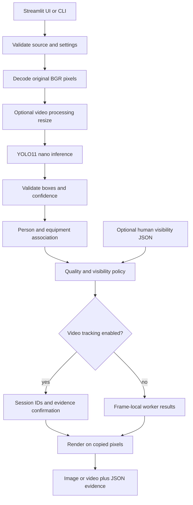

# How the PPE pipeline works

This is the current implementation guide for **PPE Vision**, reviewed on
16 November 2026. Start with this document, then read the
[code walkthrough](code-walkthrough.md) and [demo guide](presentation-guide.md).

## 1. Purpose and system boundary

The application assists a human reviewer by locating people, helmets and safety
vests, associating equipment with workers, and explaining visible evidence.
It runs inference locally using a fine-tuned YOLO11 nano model. It does not call
an external AI API. Training is a separate, offline development activity performed
on a Colab GPU; opening the application does not retrain the model.

The three labels are `person`, `helmet`, `vest`. The source vest label includes
high-visibility shirts and jackets. Detection alone does not establish that an
item is correctly worn, certified, or sufficient for all hazards.

## 2. Architecture

The UI and CLI call the same Python services. Business rules live under
`src/ppe_compliance`; the UI is an adapter, not a second compliance engine.

## 3. Data and model preparation

1. `scripts/prepare_dataset.py` audits and converts the downloaded dataset.
2. Source IDs `5=Person`, `0=helmet`, `2=vest` become prepared IDs
   `0=person`, `1=helmet`, `2=vest`.
3. The reviewed development split contains 799 training and 200 validation
   images. Background images are retained. One training exclusion is recorded.
4. `scripts/build_colab.py` packages the training workflow. The baseline uses
   YOLO11 nano initialization, 30 epochs, image size 640, batch 8 and seed 42.
5. The selected `best.pt` is placed at `models/best.pt`. Runtime class names are
   read from the weights; assessment rejects weights without all three classes.

Weights and full datasets are local artifacts and are excluded from Git.
The included UI sample is a validation image with attribution in
`app/assets/README.md`; it is deliberately labeled as demonstration evidence.
An independent test set has not been supplied. See [data audit](dataset-audit.md).

## 4. Image request, step by step

1. The user selects a file or the included sample, a processing profile and
   optional confidence/device settings.
2. `decode_image_bytes()` checks nonempty bytes, the 200 MB byte limit and a
   supported image signature. Explicit Pillow format readers inspect dimensions
   before OpenCV allocates decoded pixels. Inputs over 24 megapixels are rejected.
   This validation avoids Ultralytics' patched `PIL.Image.open` plugin installer.
3. OpenCV decodes a three-channel **BGR** array. RGB is used only where a display
   library needs it; the model receives OpenCV-compatible pixels.
4. `FrameDetector` loads the selected model. `detect()` calls `model.predict()`
   with the chosen confidence, input size and device. Ultralytics handles model
   preprocessing, prediction and its normal detection postprocessing.
5. `validated_model_detections()` rejects non-finite scores, degenerate/inverted
   boxes and boxes outside the image. It records rejection reasons and retains
   valid outputs. Accepted coordinates are not fabricated or expanded.
6. `assess_detections()` checks the class map, calls `associate_ppe()`, and derives
   each worker's status and reasons.
7. `draw_assessment()` annotates a copy of the image. Original pixel dimensions
   are retained; the annotated export is lossless PNG.
8. The UI service writes all four files into a temporary staging directory and
   renames that directory only after every save succeeds. A failed image save
   cannot leave a published, apparently complete run.
9. Streamlit retains `(input_fingerprint, result)` in `session_state`. Changing
   input/settings hides stale results. Ordinary UI reruns do not rerun inference.

Each image action loads its own detector. Video jobs reuse one loaded detector
across their frames. There is no shared, mutable global model cache.

## 5. Detection and ownership are different decisions

A model produces boxes `[left, top, right, bottom]` in pixel coordinates and a
confidence score for each detected object. Geometry then asks which worker could
plausibly own an equipment detection.

For a person box `(left, top, right, bottom)` with width `w` and height `h`:

| Equipment | Candidate region |
| --- | --- |
| Helmet | x from `left - .05w` to `right + .05w`; y from `top - .08h` to `top + .32h` |
| Vest | x from `left - .02w` to `right + .02w`; y from `top + .16h` to `top + .72h` |

The equipment center must lie inside the region, at least 65% of its area must
overlap that region, and its size must be plausible for that person. The score is
`0.8 × region coverage + 0.2 × horizontal centering`. This is a heuristic ownership
score, not a probability that the equipment is worn.

Candidate ownership within a score margin of 0.15 is ambiguous. A single item is
never awarded to two workers. Weak equipment becomes uncertain; extra candidates
are logged as unmatched. A narrowly defined bottom-cropped vest exception allows
torso ownership but the border warning still requires review.

## 6. Why a visible helmet may still require review

The detection confidence default is **0.25**; the association evidence threshold
defaults to **0.50**. These serve different purposes. Lowering the UI detection
threshold exposes more candidates; it does not make weak evidence acceptable.

Default quality gates in `AssociationRules`:

| Rule | Default and purpose |
| --- | --- |
| Person confidence | At least 0.50 |
| Person dimensions | At least 80 px tall and 20 px wide at the heuristic model-input scale |
| Equipment size | At least 5 px at that scale |
| Region coverage | At least 0.65 |
| Ownership margin | Competing scores within 0.15 require review |
| Worker overlap | IoU at least 0.35 warns of occlusion |
| Image border | Within 2 model-scale pixels warns of truncation |

Scale gates use `image_size / max(image_width, image_height)` as a heuristic
projection. They are not a physical distance estimate or calibrated visibility
model. Changing the input size can change both detection quality and these gates.

## 7. Status policy

| Status | Trigger |
| --- | --- |
| PPE detected | Both items have plausible strong matches and no quality/visibility warnings |
| review required | Any warning, uncertain ownership, or missing item without explicit visible-region review |
| potential violation | Missing item in a human-confirmed visible region, with no other warning |

The UI does not silently infer head/torso visibility. Without human visibility
input, missing PPE defaults to **review required**. Potential violations can be
produced by `ppe assess --visibility reviewed.json`; the file must match the exact
source SHA-256, worker IDs and current boxes. See [image rules](phase-4.md).

The decision priority is **warning → review**, otherwise **visible missing
item → potential violation**, otherwise **both matches → PPE detected**.
Zero detected workers yields zero counts and a review message, never a safety claim.

## 8. Three video/camera execution paths

| Path | Behavior | Coverage and output |
| --- | --- | --- |
| Analyze every frame | Sequential decode, infer, assess, track, render and encode | Every processed frame; full coverage only if run reaches end of stream |
| Smooth recorded review | Original-rate source playback plus independent sampled AI pane | Selected-frame evidence; no all-frame accuracy/coverage claim |
| Low-latency camera | Capture and inference run separately; display keeps moving | Latest selected frames; recording is optional |

Full analysis defaults to a **300-frame limit in the UI**; set it to 0 for a full
video. A 1080p processing cap fits within 1920×1080 without upscaling smaller
sources. Efficient dashboard export produces one 1280×720 H.264 movie. Frame-only
export fits within 1920×1080. A native-resolution export is an explicit extra.
Silent output preserves nominal source FPS; it does not preserve audio or
variable-rate presentation timestamps.

Live capture uses a single latest-frame slot. When inference is slower than
capture, unselected older frames are intentionally replaced instead of queued.
The raw moving pane never displays boxes from a different frame. The scored pane
owns its exact source frame and timestamp; stale results are hidden. Model warmup
and large recorded-source playback preparation add startup delay.

The UI defaults to **In this browser** for camera and sampled recorded review.
`browser_preview.py` runs the existing headless engine in an isolated process and
publishes an atomic latest JPEG/status pair. A Streamlit fragment refreshes only
the live panel; Start/Stop stays responsive during inference. Windows reader-lock
collisions are retried before publishing a replacement snapshot.

The camera still belongs to the computer running Streamlit; this does not use
the visiting browser's camera API. Preview updates are sampled independently of
source and AI rates. Stop requests allow report cleanup, then bound a stalled
worker shutdown. If browser heartbeats cease for 20 seconds, the worker stops.

Optional **Desktop window** retains the native UI on the Streamlit host. Q/Esc
closes that monitor; Tab changes focus and F toggles camera fullscreen. Automated
camera fixtures do not open physical devices.

## 9. Tracking

`WorkerTracker` uses box IoU and one-to-one geometric association. It does not use
face recognition or appearance re-identification. `T001` is a session-local label.
Crossings and occlusion can retire IDs or create new ones.

Default green confirmation requires three observations spanning at least 0.2 s.
Unknown current evidence removes green immediately. A gap over 0.5 s expires
evidence; tracks retire after 1.2 s. Events log starts, losses and confirmed status
transitions, not a repeated alert for every frame.

## 10. Output contracts and provenance

| Artifact | Meaning |
| --- | --- |
| `annotated.png` | Original-size lossless image with overlays |
| `detections.json` | Raw accepted boxes, class map, scores, model hash and rejected-output audit |
| `compliance.json` | Worker matches, status, reasons, rules and source hash |
| `visibility-template.json` | Optional human head/torso visibility input template |
| `dashboard.mp4` / `annotated.mp4` | Selected video presentation export |
| `frames.jsonl` | One self-contained evidence row per analyzed video frame |
| `events.jsonl` | Session-local tracking transitions when tracking is enabled |
| `summary.json` | Settings, counts, processing timing, coverage and stop/error reason |

Image source hashes identify uploaded compressed bytes. Video frame hashes
identify decoded BGR bytes or resized processing bytes, as declared in the report.
With resized analysis, multiply x/y coordinates by `source_coordinate_scale` to
map them back to original source pixels. A detection ID indexes the accepted
companion list, not an arbitrary model tensor index.

Video writes stream to disk without retaining all frames in memory. Failures close
writers/capture/logs independently and preserve a failed summary and partial rows.
Image exports are atomic as a group; video exports are intentionally partial on failure.

## 11. Performance and evaluation

Processing FPS measures completed frame work including rendering/encoding/report
work within the documented timer scope. Display FPS measures UI/source updates.
Playback FPS is encoded media timing. These values cannot be substituted for one
another. CPU/GPU, resolution, model input, warmup and clip duration affect results.

The saved baseline reports validation precision 94.99%, recall 83.54%, mAP50
90.08% and mAP50–95 71.15%. These are object detection metrics from development
validation data, not independent worker-level compliance accuracy.

`evaluation.py` accepts a frozen human-reviewed manifest, verifies hashes and
exact overlap exclusions, and matches workers greedily by descending IoU.
Missed workers and spurious predictions contribute to metrics. Review is an
abstention; an empty denominator yields `null`. Hashes detect exact duplicates,
not similar scenes. Independent evaluation remains an external data requirement.
