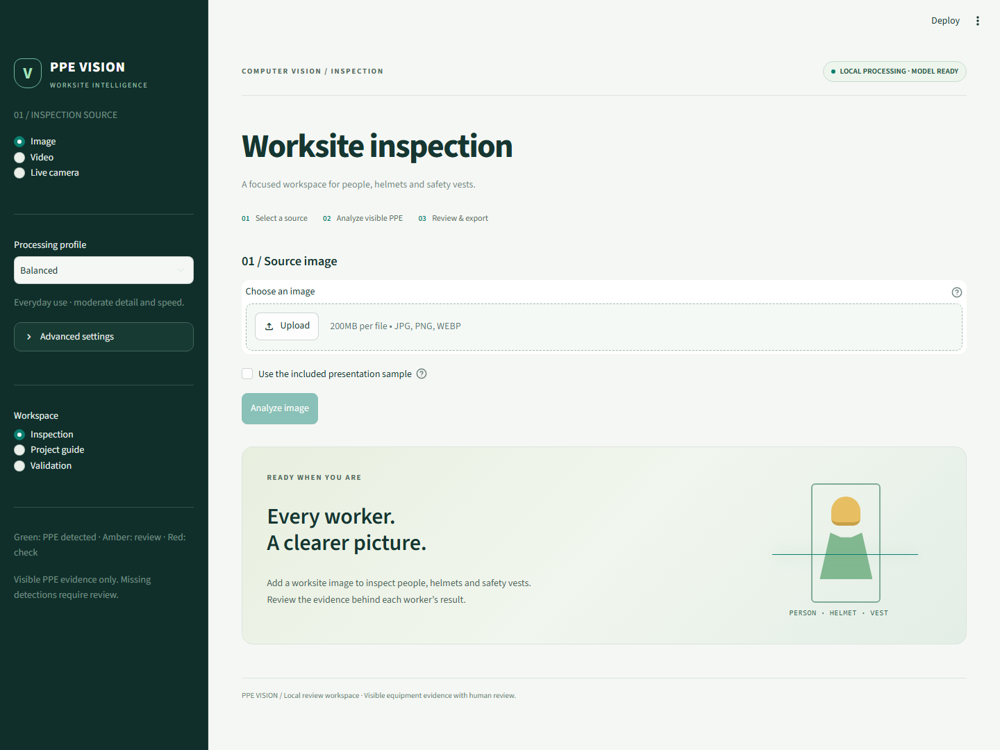

# PPE Vision: Worker PPE Detection and Evidence Review

Final implementation report. Status: 16 November 2026.

This report documents the implemented software and recorded development evidence.
Independent final accuracy evaluation remains pending suitable human-reviewed
real-camera data. Team names and institutional details are intentionally left
for the project members to supply.

## 1. Abstract and project objectives

PPE Vision is a local computer-vision prototype for reviewing workers, helmets
and high-visibility safety clothing in images, recorded video and camera feeds.
A fine-tuned YOLO11 nano detector supplies object locations and scores. A separate
geometry-based association layer assigns plausible equipment ownership, and a
conservative policy explains whether the evidence supports PPE detected, review
required or a human-reviewable potential violation.

The project combines dataset auditing, model fine-tuning, worker evidence rules,
session tracking, video processing, structured reporting, an inspection interface
and reproducible software checks. It assists a reviewer; it does not establish
overall site safety or prove that a detected object is worn correctly.

The implemented objectives are three-class local inference, understandable
worker-level evidence, uncertainty-aware results, recorded/live workflows,
artifact export and an explainable demonstration. Independent worker accuracy and
sustained deployment speed are evaluation objectives still requiring new data.

## 2. Current implementation and scope

| Area | Position at this report |
| --- | --- |
| Environment and CLI | Installed local Python package; image, video and camera commands |
| Dataset preparation | Audited three-class training/validation derivative |
| Model training | Recorded 30-epoch Colab baseline; selected weights checked locally |
| Worker evidence | Head/torso ownership, uncertainty, visibility and explanatory statuses |
| Video | Every-frame processing, tracking, H.264 dashboard and JSONL reports |
| Camera and smooth review | Separate moving source and timestamped sampled AI panes |
| Frontend | PPE Vision inspection workspace, comparison, worker evidence, guides and validation page |
| Software checks | Unit, integration, UI, browser and real-model smoke verification |
| Independent evaluation | Runner implemented; final independent data and results pending |

No restricted-zone model, face identification, equipment certification check or
autonomous enforcement system is claimed. Runtime inference uses local weights,
not a paid or remote AI API.

## 3. Dataset, provenance and preparation

The selected development source is Ultralytics Construction-PPE, retrieved in
November 2026. Its source IDs Person=5, helmet=0 and vest=2 were remapped to
person=0, helmet=1 and vest=2. The reviewed split contains 799 training and 200
validation images; one training exclusion is documented and background examples
are retained.

Preparation validates annotations and records hashes, exclusions and class counts.
It refuses to overwrite an existing prepared destination. Machine-specific
dataset YAML, full data and model weights remain local ignored artifacts.

The source vest class includes high-visibility shirts and jackets. Annotation
completeness, recurring/generated scenes and lack of an independent test split
limit the claims supported by this development source. Randomly selecting more
nearby frames from the same scenes would not establish independence.

Dataset/sample attribution and publisher-stated CC BY 4.0 image/annotation terms
are recorded in docs/dataset-attribution.md. Software/model licensing is a separate
distribution consideration. The included UI sample is an unmodified development
validation image; overlays are generated on a copy.

## 4. Training and saved validation results

The recorded baseline fine-tuned YOLO11 nano on a Colab Tesla T4 for 30 epochs
using image size 640, batch 8 and seed 42. The saved best model is used at runtime;
the app does not retrain. Model classes are read from the weights and PPE
assessment rejects general weights lacking the three required labels.

| Development validation metric | Recorded result |
| --- | --- |
| Mean precision | 94.99% |
| Mean recall | 83.54% |
| mAP at IoU 0.5 | 90.08% |
| mAP at IoU 0.5:0.95 | 71.15% |

| Class | Precision | Recall | F1 |
| --- | --- | --- | --- |
| Person | 95.26% | 87.32% | 91.11% |
| Helmet | 92.82% | 76.53% | 83.89% |
| Vest | 96.88% | 86.76% | 91.55% |

These values come from docs/experiments/baseline-001/validation-metrics.json.
They are object detection validation measurements, not independent compliance
accuracy. Helmet recall is the weakest class result. Validator operating points
are not necessarily the UI's default confidence threshold.

The checked model SHA-256 is
42538d40127ef78117cfade974369bf8ae993182442232b8faf670fd4cbc1448.
Training configuration, provenance and environment evidence are retained separately
from runtime artifacts.

## 5. Runtime architecture and data flow

The main data flow is:

```text
UI / CLI -> validate input -> decode BGR pixels -> YOLO prediction
         -> validate boxes -> associate PPE -> explain worker status
         -> optional session tracking -> render copy -> export evidence
```

detector.py loads the model and adapts its results to plain Python data.
association.py performs geometric ownership. compliance.py applies visibility and
quality policy. rendering.py draws evidence. tracking.py handles session-local
identity and confirmed changes. video_pipeline.py streams every-frame work;
live_pipeline.py and recorded_preview.py separate moving source display from
sampled AI. interface.py and the Streamlit app adapt this shared core to user
actions. evaluation.py measures frozen worker outcomes.

Images are decoded as BGR arrays. Detections contain class name/ID, confidence
and [left, top, right, bottom] pixel coordinates. Workers contain person evidence,
helmet/vest ownership states, quality issues, status and reasons. Reports include
the source/model hashes, settings and coordinate interpretation.

Still-image actions load a detector per analysis. Video loops reuse one detector
across frames. There is no global shared mutable model cache.

## 6. Equipment ownership and uncertainty policy

Helmet centers must plausibly lie in a head region spanning approximately the
top 32% of a person box, with a small allowance above/around the box. Vests must
plausibly occupy the upper/middle torso. Region coverage, relative dimensions,
horizontal alignment and evidence strength gate candidate ownership.

The association score weights region coverage by 0.8 and horizontal centering by
0.2. Coverage must be at least 0.65. Candidate scores within 0.15 are ambiguous.
A single equipment detection cannot satisfy two workers. Extra candidates and
unmatched/weak items are retained in diagnostics.

The default detector threshold of 0.25 retains candidates; the evidence threshold
of 0.50 determines whether matches are sufficiently strong. Small people/equipment,
border truncation, worker overlap and ambiguous ownership trigger review. A
bottom-cropped vest exception can preserve a plausible torso match, but border
visibility still prevents an unsupported positive decision.

| Worker status | Interpretation |
| --- | --- |
| PPE detected | Both required items plausibly match and no quality/visibility warning applies |
| review required | Uncertain evidence, missing item with unknown visibility or another quality warning |
| potential violation | Item unconfirmed in an explicitly human-reviewed visible region, with no competing warning |

The UI does not automatically infer region visibility. Human visibility JSON is
optional in the image CLI and is bound to the exact source hash and current boxes.
Zero workers does not establish an empty or safe scene. Detected equipment does
not prove wearing state.

## 7. Recorded video, camera and tracking

Every-frame recorded analysis decodes each processed frame, optionally resizes
the processing pixels, predicts, assesses, tracks, renders and writes video/JSONL.
The UI defaults to a bounded 300-frame preview; limit 0 requests the whole source.
A frame-limit stop is labeled as such and must not be presented as full coverage.

Efficient export produces a browser-compatible H.264 dashboard at 1280x720 or a
frame-only movie up to 1920x1080. Native export is an optional extra. Output is
silent and uses nominal constant-rate timing. Video reports identify processing
dimensions, frame-hash scope and coordinate scales back to original source pixels.

Smooth recorded review and the low-latency camera use independent source display
and selected-frame AI. A latest-frame handoff replaces stale queued candidates.
The moving source never receives boxes from a different frame; the scored pane
contains its own source frame and timestamp, and hides stale results. This is
sampled evidence rather than every-frame compliance coverage.

Tracking uses one-to-one box IoU, not faces or appearance re-identification. IDs
are session-local and can change at crossings. Default green confirmation needs
three observations spanning at least 0.2 seconds; uncertain current evidence
removes green immediately. Evidence expires after a 0.5-second gap and tracks
retire after 1.2 seconds. Transition events avoid repeated alerts per frame.

Processing FPS, display FPS and playback FPS describe different measurements.
Hardware, source resolution, model input and warmup must accompany any speed
claim. Short smoke runs do not establish sustained real-time operation.

## 8. Frontend and presentation workflow

The local Streamlit frontend uses a green/navy navigation rail, a readable light
inspection canvas, explicit source modes and a consistent evidence palette.
Image results include summary counts, annotated/source-comparison tabs, filterable
worker cards and selected-file downloads. Changed source/settings hide stale
results. The included attributed sample supports repeatable rehearsal.

Project guide explains the six pipeline stages and important code entry points.
Validation reads the actual saved baseline metrics and states their limitations.
Documentation downloads support offline viva preparation. The native camera/video
dashboard shares the PPE Vision name and palette.

Camera and sampled video review now default to an embedded browser dashboard
with Start/Stop controls. An isolated headless worker publishes atomic JPEG/status
snapshots to a Streamlit fragment, with heartbeat expiry and bounded cancellation.
The camera is attached to the app host, not a remote visitor's device. Browser
refresh, source playback and AI inference have distinct rates. Optional native
windows retain Q/Esc and Tab controls.



## 9. Reliability and error handling

Input validation rejects invalid settings, unreadable files and oversized decoded
images before expensive inference. Explicit image readers avoid the installed
Ultralytics Pillow hook that can attempt HEIF package installation for a corrupt
input. Model-output validation drops malformed predictions with an audit trail
while retaining valid detections and source frames.

Image exports are staged and published as a complete directory only after all
files are saved. Video failures retain previous evidence and a failed summary;
writers, capture and logs close independently even if another cleanup step fails.
Encoder completion is checked. Odd dimensions receive at most one padding pixel
for the selected MP4 pixel format, with coordinate semantics preserved.

The camera launcher now forwards user confidence. Invalid GPU/MPS assertions
become actionable device errors. Preview/download views handle moved or missing
artifacts. A successful encoder exit alone is insufficient: preview files must
exist and be nonempty. Selected-file downloads avoid buffering every video on
each Streamlit rerun.

## 10. Verification strategy and evidence

The original 180-test suite passed before finalization. Additional regression
checks cover invalid public image settings, decoded-size guards, offline corrupt
input rejection, staged write failures, camera confidence, missing previews,
unavailable devices and expanded interface behavior.

The browser-preview update's recorded suite passes 212 tests with no skips. Actual CLI checks also
verify invalid confidence/image-size rejection and unavailable CUDA recovery.
The browser check uploads, analyzes, exports and plays a short scored H.264 clip
without a media error, in addition to image/evidence and navigation checks.

Tests use controlled geometry and fake model/camera backends to verify policy,
one-to-one ownership, temporal behavior, timing, failure cleanup and output
contracts without requiring training downloads or a physical camera. AppTest
verifies UI navigation and state. Browser checks verify real rendering and sample
inference, including a narrow viewport.

The repeatable presentation verifier checks dependencies and the automated suite,
then uses the selected weights for actual CPU image inference and an eight-frame
synthetic video. It reads the H.264 output back and verifies dimensions, frame
count, FPS, JSONL rows and exact source timestamps. Detailed current evidence is
in docs/experiments/final-readiness/verification.json and the local generated logs.

The smoke clip repeats a development validation still. It is an integration
fixture, not natural-motion or independent accuracy evidence. Current CUDA and
physical camera behavior are not established by this CPU audit.

## 11. Final evaluation plan and limitations

Independent worker evaluation requires a frozen reviewer-annotated manifest of
real-camera scenes. Split by site/camera/session before sampling to avoid
near-duplicate leakage. Include distance, overlap, lighting, truncation, held
equipment and background cases. Do not tune on the final test set.

The evaluator verifies hashes and exact exclusion overlap, matches expected and
predicted people greedily by descending IoU, and includes missed/spurious workers.
It reports worker detection precision/recall, status precision/recall/F1, review
rate, confusion, accuracy on matched workers and correct status per expected
worker. Empty denominators are null. Scene independence remains reviewer-declared;
hash checks cannot prove it.

Important limits remain helmet recall, geometric wearing-state ambiguity,
tracking ID switches, variable-rate video timing, driver buffering and CPU speed.
The work is ready for a software demonstration with these limits stated. It is
not a certified industrial safety system or a completed independent evaluation.

## 12. Reproduction and presentation preparation

Run from the project root with Python 3.10+ for the application. Packaging scripts
may require Python 3.11+. The checked Windows environment uses Python 3.13.

```powershell
python -m venv .venv
.\.venv\Scripts\python.exe -m pip install -e ".[ui]"
.\.venv\Scripts\python.exe -m pip check
.\.venv\Scripts\python.exe scripts/verify_presentation.py
.\.venv\Scripts\python.exe -m streamlit run app/streamlit_app.py
```

Restore trained weights to models/best.pt before rehearsal. Installation requires
internet; runtime with local inputs/weights does not. Keep a verified exported
video and reports as backup. Rehearse the sample, worker reasons, changed settings,
downloads, pipeline page and validation limits before presenting.

The documentation pack contains docs/pipeline.md for architecture,
docs/code-walkthrough.md for code/viva preparation, docs/presentation-guide.md for
the demo script and recovery steps, docs/final-audit.md for findings, and
docs/submission-slides.md for slide content and speaker notes.

The prior Phase 3 report source is preserved in
docs/archive/phase-3-project-report.md as historical material. The current report
supersedes its implementation status; baseline metrics remain unchanged.
